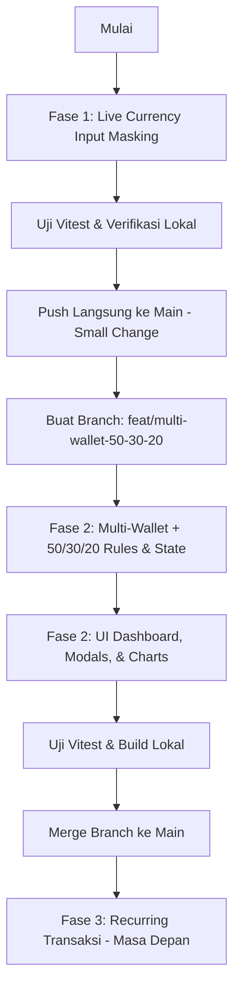

# PRD: Live Currency Masking, Multi-Wallet & 50/30/20 Breakdown Integration

**Project:** `finance-dashboard`  
**Status:** Approved for Implementation  
**Prioritas:**
1. **Fase 1 (Segera / Quick Win):** Live Currency Input Masking (`Rp` thousand separator pada form nominal).
2. **Fase 2 (Fitur Signifikan):** Integrasi Multi-Wallet (Kantong Keuangan) + Breakdown Rasio 50/30/20.
3. **Fase 3 (Prioritas Terakhir / Deferred):** Transaksi Berulang & Manajemen Langganan (*Recurring / Subscriptions*).

---

## 1. Aturan Workflow Git & Kontribusi AI Agent

Sesuai instruksi operasional, AI agent dan kontributor wajib mematuhi aturan berikut:
1. **Tidak Boleh Push per Micro-Change:** Dilarang melakukan `git push` setelah setiap perubahan baris/file kecil. Kumpulkan perubahan terkait ke dalam satu batch yang telah diverifikasi lokal (`npm test` dan `npm run build`).
2. **Strategi Branching Berdasarkan Signifikansi:**
   - **Perubahan Kecil / Quick Win (Contoh: Live Currency Input Masking, bug fix kecil, copy text):** Boleh langsung di-commit dan di-push ke branch `main` setelah verifikasi lokal lulus.
   - **Perubahan Signifikan / Fitur Kompleks (Contoh: Multi-Wallet + 50/30/20 Integration, migrasi skema database, modifikasi Firestore rules):**
     1. Buat branch baru dari `main`: `git checkout -b feat/<nama-fitur>`.
     2. Kerjakan seluruh modul dan verifikasi lokal (Vitest, lint, build).
     3. Commit dan push branch fitur tersebut.
     4. Lakukan merge ke branch `main` (misal via PR atau fast-forward merge setelah seluruh acceptance criteria terpenuhi).

---

## 2. Spesifikasi Teknis Tiap Fitur

### FASE 1: Live Currency Input Masking (Prioritas 1 — Quick Win)

#### 2.1 Latar Belakang & Masalah
Saat ini input jumlah nominal di modal (Tambah Pemasukan, Tambah Pengeluaran, Set Anggaran) berupa input teks/number polos tanpa pemisah ribuan. Pengguna sering keliru mengetik jumlah nol (misal: `500000` terbaca `5000000`).

#### 2.2 Desain & Perilaku Komponen
- **Nama Komponen:** `CurrencyInput` (diintegrasikan di [`remaster/src/components/CustomInputs.jsx`](file:///c:/Users/Lenovo/Documents/Obsidian/Projects/finance-dashboard/remaster/src/components/CustomInputs.jsx)).
- **Tampilan Visual:**
  - Saat input kosong: placeholder `0` atau `Rp 0`.
  - Saat pengguna mengetik `50000`: menampilkan `Rp 50.000` (atau `50.000` dengan prefix Rp statis).
  - Mendukung input angka murni, paste angka, backspace, dan seleksi sebagian teks.
- **Nilai State Form:**
  - Nilai yang dikirimkan ke handler form (`onChange`) tetap berupa nilai numerik valid (`number` murni, contoh: `50000`) atau string angka murni (`"50000"`), sehingga **100% kompatibel** dengan fungsi `validateAmount` dan `FinanceContext` tanpa breaking changes.
- **Lokasi Penggunaan:**
  - Modal Tambah/Edit Pengeluaran (`ExpensePage.jsx`).
  - Modal Tambah/Edit Pemasukan (`IncomePage.jsx`).
  - Modal Set Anggaran (`BudgetPage.jsx`).
  - Modal Cepat di Dashboard (`DashboardPage.jsx`).

#### 2.3 Kriteria Penerimaan (Acceptance Criteria) Fase 1
- [ ] Pengguna mengetik angka di form transaksi dan otomatis muncul pemisah titik ribuan secara *real-time*.
- [ ] Nilai nominal tersimpan di Firestore tetap berupa `number` integer yang benar.
- [ ] Unit tests untuk `CurrencyInput` lulus (menangani format, paste teks kotor seperti `Rp 50.000`, backspace, dan batas nominal).
- [ ] Di-commit dan di-push ke `main` (kategori perubahan kecil/quick win).

---

### FASE 2: Multi-Wallet (Kantong Keuangan) + Integrasi Rasio 50/30/20 (Prioritas 2 — Fitur Signifikan)

#### 2.4 Latar Belakang & Masalah
- Pengguna Indonesia memiliki likuiditas terfragmentasi: Rekening Bank (BCA, Mandiri), E-Wallet (GoPay, OVO, ShopeePay), dan Tunai (Cash).
- Dashboard saat ini menampilkan total pengeluaran gelondongan tanpa mengetahui:
  1. Uang tunai/saldo ada di mana.
  2. Apakah pengeluaran lebih banyak terserap untuk Kebutuhan Pokok (*Needs* 50%), Keinginan (*Wants* 30%), atau Tabungan (*Savings* 20%).
  3. Bagaimana korelasi antara dompet dan gaya hidup (misal: GoPay 90% lari ke *Wants*, sedangkan BCA 80% lari ke *Needs*).

#### 2.5 Desain Skema Data (Database Schema & Security Rules)
1. **Koleksi Dompet / Wallets:**
   - Path Firestore: `/users/{uid}/wallets/main` (berisi array `wallets`).
   - Objek `Wallet`:
     ```typescript
     interface Wallet {
       id: string;        // e.g. "bca-utama", "gopay", "tunai"
       name: string;      // e.g. "BCA", "GoPay", "Uang Tunai"
       type: "bank" | "ewallet" | "cash";
       color: string;     // HEX code e.g. "#1E56D1"
       icon: string;      // Lucide icon name e.g. "Landmark", "Smartphone", "Wallet"
       isDefault: boolean;
     }
     ```
   - **Default Fallback Wallets:** Jika belum ada, sistem menyediakan 3 dompet default:
     - *Rekening Bank (BCA)*
     - *Dompet Digital (GoPay/E-Wallet)*
     - *Tunai (Cash)*
2. **Kategori Finansial dengan Alokasi 50/30/20 (`tier`):**
   - Setiap kategori expense memiliki field `tier`:
     - `"needs"` (Kebutuhan Pokok — target 50%)
     - `"wants"` (Keinginan & Hiburan — target 30%)
     - `"savings"` (Tabungan & Dana Darurat — target 20%)
3. **Pembaruan Transaksi (Expense & Income):**
   - Setiap transaksi memiliki field opsional `walletId: string` (menunjuk ke dompet sumber pembayaran/penerimaan).
4. **Pembaruan `firestore.rules`:**
   - Tambahkan match path `/users/{userId}/wallets/{walletId}` dengan whitelist keys dan validasi `all(isValidWallet)`.
   - Perbarui `isValidCategory` dan whitelist keys agar mendukung field `tier`.
   - Perbarui shape expense/income agar mengizinkan field `walletId`.

#### 2.6 Tampilan UI & Integrasi Visual
- **Dashboard & Header:**
  - Widget **"Kantong Keuangan" (Wallets Bar)**: Menampilkan kartu dompet dengan saldo estimasi/akumulasi bulan berjalan dan ikon yang elegan.
  - Kartu **"Kesehatan Finansial (Aturan 50/30/20)"**:
    - Progress bar tiga warna: Needs (Biru), Wants (Kuning/Oranye), Savings (Hijau).
    - Status visual: *"Sehat"* atau *"Wants Melebihi 30%"*.
    - Breakdown detail per dompet: *"GoPay mendominasi 65% pengeluaran Wants bulan ini"*.
- **Modal Transaksi:**
  - Tambahan dropdown pemilihan Dompet (*Wallet Selector*) pada form Tambah/Edit Transaksi.

#### 2.7 Kriteria Penerimaan (Acceptance Criteria) Fase 2
- [ ] Dikerjakan di branch baru: `feat/multi-wallet-50-30-20`.
- [ ] Firestore rules divalidasi dengan unit test emulator/static analysis sebelum merge.
- [ ] Pengguna dapat memilih dompet saat mencatat pengeluaran/pemasukan.
- [ ] Dashboard menampilkan rasio 50/30/20 yang bereaksi secara *real-time* saat transaksi bertambah.
- [ ] Seluruh unit test Vitest lulus (target: >85 tests).
- [ ] Branch fitur di-merge ke `main` setelah seluruh pengujian lulus.

---

### FASE 3: Transaksi Berulang & Langganan (*Recurring / Subscriptions*) (Prioritas Terakhir)

#### 2.8 Deskripsi Singkat
- Manajemen tagihan bulanan (listrik, wifi, streaming, asuransi, gaji) yang otomatis ditagihkan di awal bulan atau memiliki tombol *1-click apply*.
- Menggunakan koleksi `/users/{uid}/templates/`.
- Ditunda hingga Fase 1 dan Fase 2 selesai dan stabil di production.

---

## 3. Rencana Eksekusi Bertahap (Execution Roadmap)


